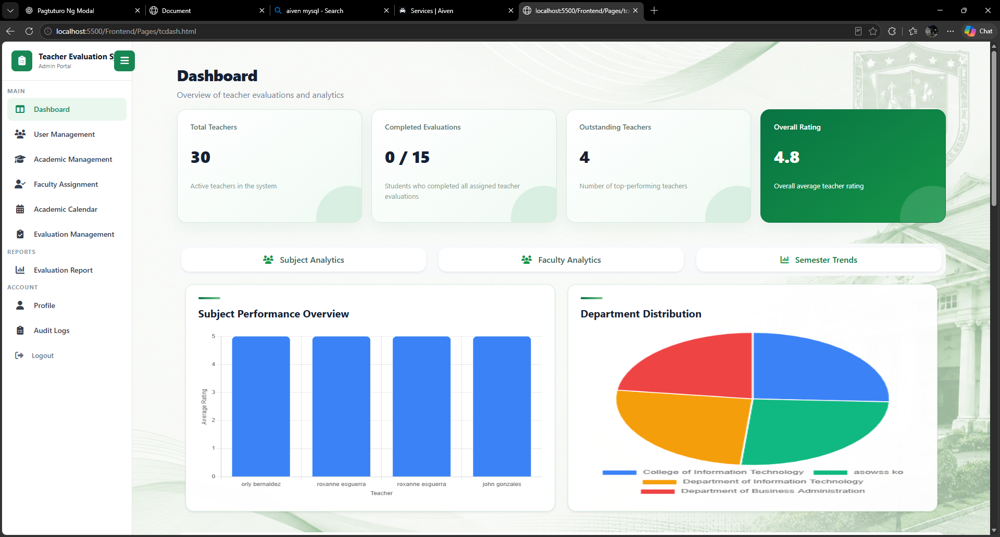
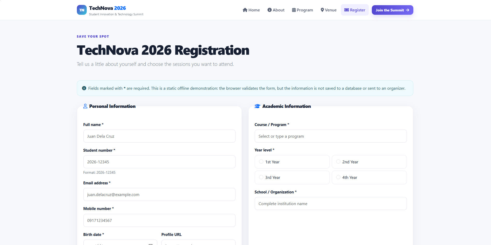

# SYSTEM DOCUMENTATION
## Resume and Portfolio Website

**College of Our Lady of Mercy of Pulilan Foundation, Inc.**  
**Course:** Web Systems Development — Final Examination  
**Student:** John Gonzales  
**Section:** ____________________  
**Instructor:** ____________________  
**Date:** ____________________

---

## 1. Introduction and Project Overview

The Resume and Portfolio Website is a single-page portfolio for John Gonzales, an Information Technology student focused on front-end development and practical web applications. It introduces the portfolio owner, summarizes his stated skills, and presents selected projects so a visitor can review his work and find contact information.

The design uses a dark background, bright blue accents, large headings, technology labels, and project imagery to give the site a consistent developer-focused appearance. The page is organized as one continuous scroll rather than separate pages. A fixed side navigation links directly to each section, while a compact menu control is provided on smaller screens.

### Objectives

- Introduce John Gonzales and his current development focus.
- Present the Teacher Evaluation System and TechNova 2026 as portfolio projects.
- Summarize front-end, back-end, database, and workflow skills shown on the page.
- Give visitors visible contact details, social links, and a message form interface.
- Make the main sections reachable through in-page navigation on desktop and mobile layouts.

### Scope and Limitations

The delivered page contains Home, About, Projects, Skills, and Contact sections. The Projects section is rendered by a React component and provides project cards, a project-details modal, screenshot carousel controls, and a live demo link for the Teacher Evaluation System. The contact area displays contact details and a form interface.

The Home section includes a downloadable, printable HTML CV assembled from information already displayed on the site. It can be opened in a browser and printed or saved as PDF. The contact form validates its required fields and opens the visitor’s email application with a prefilled message; it does not send through a server, so an email application must be configured. The portfolio has no backend, database, or confirmed hosting URL. The Teacher Evaluation System live demo link belongs to that project, not to this portfolio. The Teacher Evaluation System source link and TechNova external links are not supplied, so the interface does not present fabricated links.

## 2. System Features and Functionality

### Home

The Home section introduces the site with a welcome heading, the owner’s name and “Full Stack Web Developer” role, a short description, profile image, technology labels, social links, a “View work” link to Projects, a “Contact me” link to Contact, and a “Download CV” link. The CV is a standalone HTML file and can be printed to PDF from a browser.

### About

The About section describes the owner as an IT student focused on front-end development and practical applications. It also shows current-focus and approach cards and includes a link to Contact.

### Projects

The project carousel currently contains:

1. **Teacher Evaluation System** — described in the project data as a full-stack web application. Its detail modal contains screenshots for the login page, admin dashboard, faculty assignment, evaluation results, and audit logs. The listed technologies are HTML, CSS, JavaScript, Bootstrap, Node.js, and MySQL. A live demo URL is provided; no source-code URL is provided.
2. **TechNova 2026** — described as a student innovation summit website. Its detail modal contains registration, home, venue/resource guide, program/sessions, and about screenshots. No technology list or external links are provided for this entry.

Visitors can change projects with the previous/next controls or indicators. “View project” opens a modal. Within a modal, screenshot indicators and arrows change the image; left/right arrow keys also change slides, and Escape closes the modal. Clicking the backdrop or close button also closes it.

### Skills

The Skills section groups the displayed skills into Frontend Development (HTML5, CSS3, JavaScript, Bootstrap), Backend Development (Node.js, JavaScript, REST API), Database (MySQL), and Tools & Workflow (Git, GitHub, VS Code). These are portfolio claims displayed to visitors; the page does not test or certify skill proficiency.

### Contact

The Contact section displays a name, email, subject, and message form; email, phone, location, and social contact information; and an invitation to reach out. The form fields are required, and the email field uses browser email validation. On submit, JavaScript opens a prefilled `mailto:` draft; delivery depends on the visitor’s email application and is not handled by a backend. The email and phone links match the contact values displayed on the page. The social links use the same profile URLs as the Home section.

### Loading screen and navigation

A loading overlay displays a progress animation before revealing the page. The sidebar links to each section using URL fragments. JavaScript updates the active navigation item as the visitor scrolls. At widths up to 768 pixels, a menu button opens and closes the navigation; selecting a link closes the mobile menu.

## 3. Technology Stack and Tools

| Technology / tool | Use and fit in this project |
|---|---|
| HTML5 | Defines the page sections, content, navigation, forms, and images; it provides the site’s document structure. |
| CSS3 | Styles the dark and blue theme, responsive layouts, cards, carousel, and modal presentation. |
| JavaScript (ES modules) | Handles menu state, active-section navigation, loading animation, and the email-draft form handoff. |
| React 19 and React DOM | Render the interactive project carousel and project detail modals as a reusable component. |
| Vite 8 | Serves the site locally and bundles the application; its configured root points to `frontend/src` to match this repository layout. |
| Bootstrap 5.3.8 | Provides the responsive grid and utility classes used to arrange content across screen sizes. |
| Font Awesome 6.7.2 | Provides consistent icons for navigation, skills, social links, and contact details. |
| Node.js and npm | Run the Vite commands and manage the dependencies declared in `my-portfolio/package.json`. |
| Git | Tracks project revisions; Git metadata is present in the repository. |
| GitHub and VS Code | Shown in the portfolio’s Tools & Workflow section; listed as skills, not independently verified project workflow evidence. |

The project files show a configured Vite build output directory at `my-portfolio/dist`. No deployment platform or public URL for this portfolio is specified in the supplied repository, so hosting is left unclaimed here.

## 4. System Design and Site Map

```text
Resume and Portfolio Website (single page)
├── Loading overlay
├── Fixed navigation
│   ├── Home (#home)
│   ├── About (#about)
│   ├── Projects (#project)
│   │   ├── Teacher Evaluation System card → details modal → screenshot carousel
│   │   └── TechNova 2026 card → details modal → screenshot carousel
│   ├── Skills (#skills)
│   └── Contact (#contact)
└── Main content
    ├── Home / introduction and downloadable CV
    ├── About / profile and focus
    ├── Projects / React-rendered showcase
    ├── Skills / four skill groups
    └── Contact / mailto form handoff and contact details
```

The dark background and blue accents align with the technology-oriented content and keep the sections visually related. Large, high-contrast headings make the major sections easy to scan. A fixed sidebar makes section navigation available while scrolling; the mobile menu adapts that navigation to narrow viewports. Background images and project screenshots add visual context, while cards and tags group related information.

## 5. User Guide

1. **Open the portfolio.** No public deployment URL is recorded in this project. For a local copy, follow the run instructions in Section 6 and open the Vite URL printed in the terminal. The page starts with a brief loading animation.
2. **Navigate the sections.** Select Home, About, Projects, Skills, or Contact from the sidebar. The active navigation item follows the section currently in view. On a narrow screen, select the menu button first, then choose a section.
3. **Review the introduction.** In Home, read the short profile, use **View work** to jump to Projects, or use **Contact me** to open Contact. The social icons open their linked profiles. Select **Download CV** to save the CV HTML file; open it in a browser and use Print → Save as PDF to create a PDF copy.
4. **Read the profile.** Select About to view the owner’s background, focus, and approach. Use **Let’s talk** to jump to Contact.
5. **Browse projects.** In Projects, use the carousel arrows or dots to choose a project, then select **View project**. In the modal, use the arrows or indicators to browse screenshots. Use the left/right keyboard arrows to change slides; press Escape, select the close button, or click the dark backdrop to close the modal. The Teacher Evaluation System modal includes a **Live Demo** link.
6. **Review skills.** Select Skills to view the four skill groups and their listed technologies/tools.
7. **Find contact details.** Select Contact to view the displayed contact channels and form. Enter a name, valid email address, subject, and message, then choose **Send Message**. The browser opens the visitor’s default email application with the fields prefilled; the visitor must send the draft. No server receives the form directly.

### Project screenshot references

The repository includes screenshots used by the Projects detail carousel. These are screenshots of the featured projects, rather than captures of the portfolio page itself.

**Figure 1. Teacher Evaluation System — login page**


**Figure 2. Teacher Evaluation System — admin dashboard**



**Figure 3. TechNova 2026 — registration page**



For a final submission that requires screenshots of the actual portfolio interface, capture the Home page, mobile navigation, Projects modal, Skills section, and Contact section in a browser and add those current captures here. The assets above document the project screenshots visible inside the portfolio’s carousel; they do not show the surrounding portfolio layout.

## 6. Development Process and Challenges

### Process summary

The supplied files indicate a section-based build: the HTML defines the page structure; separate CSS files style the main, About, Projects, Skills, Contact, and loading sections; JavaScript modules handle navigation and loading behavior; and a React component supplies the project gallery. The Vite configuration sets `frontend/src` as the application root while package metadata and dependencies are in `my-portfolio`. The package scripts provide local development (`npm run dev`), production build (`npm run build`), preview (`npm run preview`), and lint (`npm run lint`). This documentation does not claim that these commands or cross-browser checks were run.

### Concrete integration challenge visible in the implementation

The portfolio HTML lives under `frontend/src`, while its npm package and Vite configuration live under `my-portfolio`. The React project gallery is also stored in `my-portfolio/src/Projects.jsx` and mounted into the `#projects-root` element by `frontend/src/assets/js/projects.jsx`. This split requires Vite to use a non-default root and allow the server to access the parent project directory. The configuration addresses that structure with `root`, `server.fs.allow`, and explicit React module aliases. Keeping the project gallery as a separate React component also allows each project card to maintain its own modal state and screenshot carousel state.

### Verification notes

The repository includes a build output under `my-portfolio/dist`, but this document does not treat its presence as proof of a current successful build or browser/device testing. Before submission, run the provided build and lint commands, then manually verify desktop and mobile navigation, modal controls, external links, and form behavior. Record the actual date, browser, viewport/device, and any issues found in the table below.

| Date | Browser / device | Check performed | Result / issue |
|---|---|---|---|
| __________ | __________ | Desktop sections and links | __________ |
| __________ | __________ | Mobile menu and layout | __________ |
| __________ | __________ | Project modal and carousel | __________ |

## 7. Recommendations

- Connect the contact form to a backend or trusted form service if server-side message delivery and success/error tracking are required.
- Replace the generated CV with a reviewed, complete resume when verified education, experience, and current contact details are available.
- Add the Teacher Evaluation System source URL and TechNova technology/link details if those can be shared accurately.
- Add current screenshots of the portfolio’s own sections to the final user guide; current figures only show project interfaces used inside the site.
- Add accessible labels and meaningful alternative text to project card imagery; verify keyboard focus and screen-reader behavior for the modal.
- Set a descriptive page title and verify the final site at common desktop and mobile widths.
- Record the actual deployment provider and portfolio URL once deployment is confirmed.

## 8. Conclusion and Reflection

The portfolio brings together a personal introduction, a downloadable CV, project examples, a categorized skills list, and contact information in one responsive, section-based page. The implementation combines HTML and CSS for the page, JavaScript for navigation, loading, and the email-draft handoff, and React for the project carousel and detail dialogs. The split between the page source and package directory is handled through Vite configuration, which is a useful integration detail to understand and maintain.

The current site communicates the owner’s stated focus and gives visitors ways to explore project work and contact him. Building it also requires coordinating the Vite root with the separate frontend and package folders, and keeping the project gallery’s interactive state in a reusable component. The form still relies on the visitor’s email application, a full reviewed CV needs verified personal details, and the user guide still needs screenshots captured from the current portfolio interface. These are concrete next steps for making the delivered website and its documentation more complete.

## References and Appendix

- Project source: `frontend/src/index.html`, `frontend/src/assets/css/`, `frontend/src/assets/js/`, and `my-portfolio/src/Projects.jsx`.
- Project configuration: `my-portfolio/package.json` and `my-portfolio/vite.config.js`.
- Portfolio documentation rubric supplied for the Web Systems Development final examination.
- External CSS/icon dependencies are loaded from jsDelivr and cdnjs as shown in the page source.

### Run locally

From the `my-portfolio` directory:

```sh
npm install
npm run dev
```

Open the local URL printed by Vite. The configured Vite root points to `frontend/src`; use the Vite server instead of opening `index.html` directly because the Projects section uses JavaScript modules and React.
